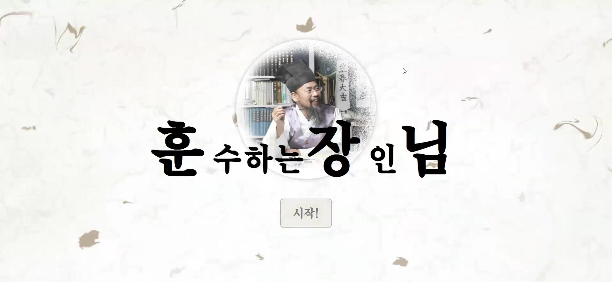
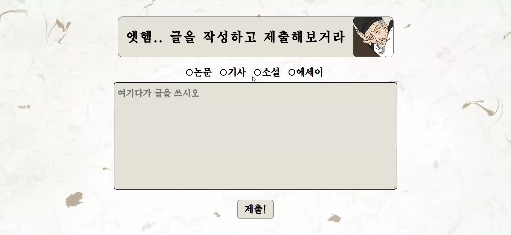
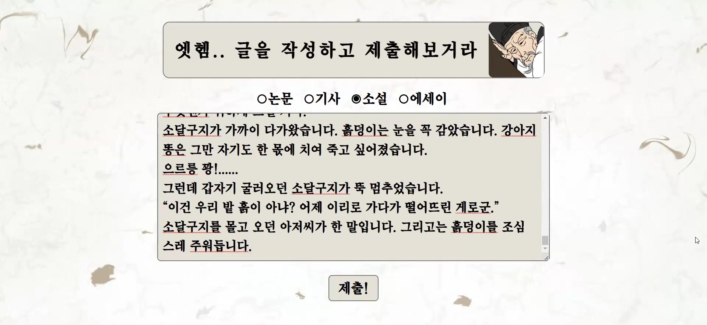
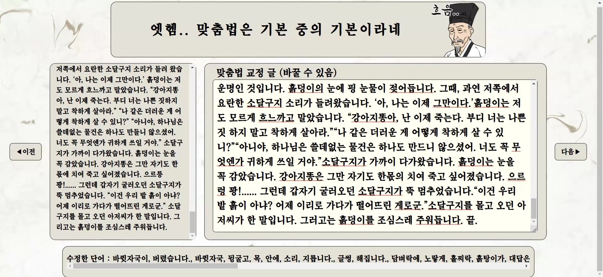
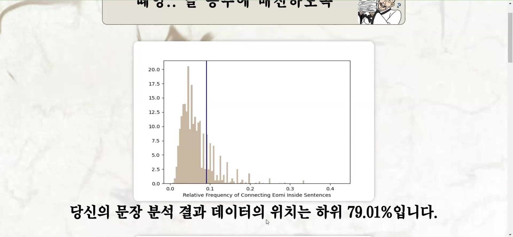
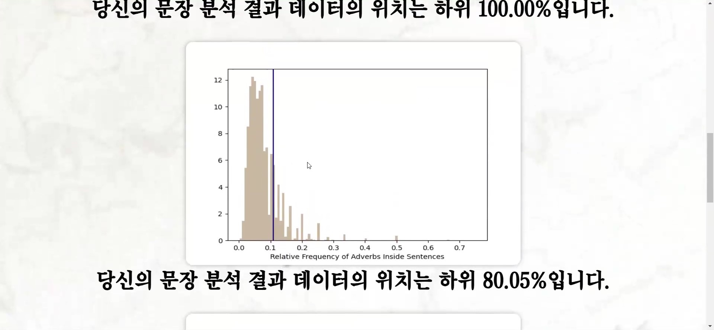

## YBIGTA 2023 DA Senior Project
# 훈장님: 훈수의 장인이 글에 훈수 두는 서비스
# Hunjangnim: Advice for Writing

Members: 이해인(haemilia), 김하영(kae1128), 오동하(Oh-dongha), 정병주(bj299)

## Explanation & Process
- Web service that shows traits of a person's Korean writing compared to other Korean writing data.
- Collected excerpts of news articles, paper abstracts, novels, and essays written in Korean.

|                 | Method of Data Acquirement |
|-----------------|----------------------------|
| News Articles   | Web Crawling               |
| Paper Abstracts | Web Crawling               |
| Novels          | Dataset on Web             |
| Essays          | Dataset on Web             |

- Used KoNLPy's Kkma POS tagging and tokenizer to find distributions of important POS tags in each text category.
- Created a web page interface for entering your own text and comparing it to our data.

## Results
- Currently not serviceable, but when deployed the outcome is like this:

